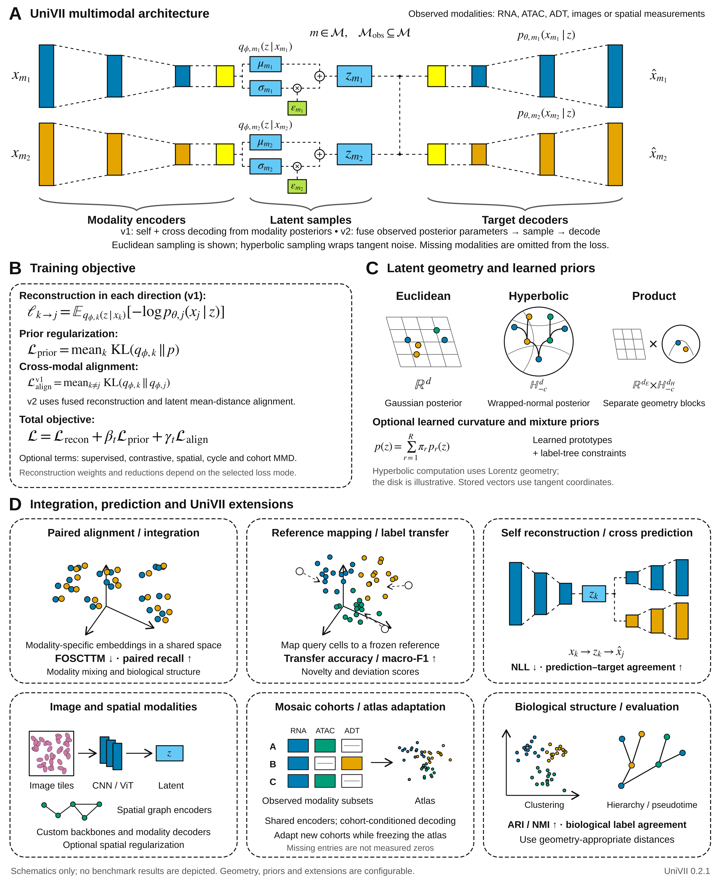

# UniVII

[](https://doi.org/10.1101/gr.281431.125)
[](https://doi.org/10.5281/zenodo.24149077)
[](https://github.com/Ashford-A/UniVII/actions/workflows/docs.yml)
[](https://github.com/Ashford-A/UniVII/blob/main/pyproject.toml)
[](https://github.com/Ashford-A/UniVII/blob/main/LICENSE)

**UniVII** is the next generation of [UniVI](https://github.com/Ashford-A/UniVI), a mixture-of-experts multimodal variational autoencoder that integrates single-cell modalities measured in the same cells (RNA, surface protein, chromatin accessibility, DNA methylation, and others) into one latent space.

It contains everything in UniVI 1.2.1 and adds:

- **Hyperbolic and product latent spaces**, with geodesic distances, anchoring at a root population, and supervision from a label tree
- **Convolutional encoders and decoders** for image tiles and ordered tracks
- **Spatial tools**: niche modalities, tissue-image tiles, spatially local batches, and a spatial smoothness prior
- **A plug-in registry** for your own encoders and decoders, including wrapped pretrained image models
- **Reference anchoring**: place new cells on a frozen model and score how far they sit from it
- **An experiment toolkit**: a learned mixture prior, contrastive alignment, linear decoders, input masking, a vision-transformer and a graph encoder, mosaic training with cohort-conditioned decoders and cohort alignment, tree and pseudotime tools, a hidden Markov model, presets, and a runner that compares configurations across seeds

UniVII is a separate package with its own name, `univii`. It does not replace, modify or conflict with the published `univi` package, and the two can be installed side by side.

<picture>
  <source media="(prefers-color-scheme: dark)" srcset="https://raw.githubusercontent.com/Ashford-A/UniVII/main/assets/figures/univi_overview_dark.png">
  
</picture>

## How this relates to UniVI

| | UniVI | UniVII (this repository) |
| --- | --- | --- |
| Status | published, stable | extensions under active development |
| Python import | `import univi` | `import univii` |
| Distribution and command | `univi` | `univii` |
| Version | 1.2.1 | 0.2.1 |
| Install | `pip install univi`, conda-forge | `pip install univii` |
| Hosted documentation | [univi.readthedocs.io](https://univi.readthedocs.io/) | the [`docs/`](https://github.com/Ashford-A/UniVII/tree/main/docs) folder; no hosted site yet |
| Dataset cache | `~/.cache/univi`, `UNIVI_DATA_DIR` | `~/.cache/univii`, `UNIVII_DATA_DIR` |

Moving code from UniVI to UniVII is a change of import. Class and function names are the same (`UniVIConfig`, `UniVIMultiModalVAE`, `UniVITrainer`, ...); `UniVIIConfig`, `UniVIIMultiModalVAE`, `UniVIITrainer` and `UniVIIRefiner` are aliases for the same classes.

```python
# before                                  # after
from univi import UniVIConfig             from univii import UniVIConfig
import univi.datasets as uds              import univii.datasets as uds
```

What carries over from UniVI 1.2.1, each covered by a test:

- With default settings the model is numerically identical: the same posteriors, KL and alignment terms.
- Reference bundles saved by UniVI 1.2.1 load, including their fitted preprocessors, whether or not UniVI is installed.
- Every UniVI tutorial runs against this code.

Kept deliberately so files written by UniVI stay readable: the AnnData keys `X_univi`, `X_univi_fused` and `univi_modality`, and the reference-bundle format `univi-reference-1`.

## Installation

Install from PyPI:

```bash
pip install "univii"
pip install "univii[tutorials]"   # adds Jupyter and scikit-misc
```

or from a clone, for development:

```bash
git clone https://github.com/Ashford-A/UniVII.git
cd UniVII
pip install -e ".[tutorials,test]"
```

UniVII requires PyTorch. If `import torch` fails, or you need a specific CUDA build, install PyTorch first from [pytorch.org](https://pytorch.org/get-started/locally/). Check the installation with:

```bash
python -c "import univii; print(univii.__version__)"        # 0.2.1
```

## Quickstart

Train on paired RNA + ATAC from 10x Multiome PBMCs (downloaded and cached on first use), then embed held-out cells and predict their gene expression from chromatin accessibility:

```python
import torch
import univii.datasets as uds
from univii import ModalityConfig, TrainingConfig, UniVIConfig, UniVIMultiModalVAE, UniVITrainer
from univii.evaluation import cross_modal_predict, encode_adata, evaluate_alignment
from univii.preprocessing import ATACPreprocessor, RNAPreprocessor, split_by_label
from univii.workflows import make_loader, save_reference

device = "cuda" if torch.cuda.is_available() else "cpu"

# 1. Paired data: one AnnData per modality, same cells in the same order
data = uds.pbmc_multiome_10k()
rna, atac = data["rna"], data["atac"]

# 2. Split, then fit preprocessing on training cells only
split = split_by_label(rna.obs["cell_type"], train_fraction=0.8, val_fraction=0.1, seed=0)
rna_prep = RNAPreprocessor(n_hvg=2000, scale=True).fit(rna[split["train"]])
atac_prep = ATACPreprocessor(n_components=101, drop_first=True).fit(atac[split["train"]])
parts = {k: {"rna": rna_prep.transform(rna[i]), "atac": atac_prep.transform(atac[i])}
         for k, i in split.items()}
train, val, test = parts["train"], parts["val"], parts["test"]

# 3. One encoder/decoder per modality, a shared 30-dimensional latent space
cfg = UniVIConfig(
    latent_dim=30, beta=1.25, gamma=4.35, encoder_dropout=0.1, decoder_dropout=0.05,
    kl_anneal_start=50, kl_anneal_end=85, align_anneal_start=75, align_anneal_end=110,
    modalities=[
        ModalityConfig("rna", train["rna"].n_vars, [512, 256, 128], [128, 256, 512], likelihood="gaussian"),
        ModalityConfig("atac", train["atac"].n_vars, [128, 64], [64, 128], likelihood="gaussian"),
    ],
)
model = UniVIMultiModalVAE(cfg)

# 4. Train with early stopping on the validation cells
UniVITrainer(
    model,
    train_loader=make_loader(train, batch_size=256, shuffle=True, drop_last=True),
    val_loader=make_loader(val, batch_size=1024),
    train_cfg=TrainingConfig(n_epochs=400, lr=1e-3, weight_decay=1e-4, device=device,
                             early_stopping=True, patience=50, best_epoch_warmup=110),
).fit()

# 5. Embed each modality, measure alignment, predict RNA from ATAC
z_rna = encode_adata(model, test["rna"], modality="rna", latent="modality_mean", device=device)
z_atac = encode_adata(model, test["atac"], modality="atac", latent="modality_mean", device=device)
labels = test["rna"].obs["cell_type"].astype(str).to_numpy()
metrics = evaluate_alignment(Z1=z_rna, Z2=z_atac, labels_source=labels, labels_target=labels)
print("FOSCTTM:", metrics["foscttm_mean"], "label transfer:", metrics["label_transfer_acc"])

rna_from_atac = cross_modal_predict(model, test["atac"], src_mod="atac", tgt_mod="rna", device=device)

# 6. Save weights + configuration + fitted preprocessing as a reusable reference
save_reference("multiome_reference", model, preprocessors={"rna": rna_prep, "atac": atac_prep})
```

The [quickstart notebook](https://github.com/Ashford-A/UniVII/blob/main/docs/tutorials/quickstart.ipynb) runs the same steps with plots and explanations.

## What UniVII adds

Each feature is off by default and switched on in the configuration.

| Feature | Switch | Guide |
| --- | --- | --- |
| Hyperbolic or product latent space | `UniVIConfig(latent_geometry="hyperbolic" \| "product")` | [Latent geometry](https://github.com/Ashford-A/UniVII/blob/main/docs/user_guide/latent_geometry.md) |
| Label-tree supervision | `hierarchy_weight`, `model.set_hierarchy(...)` | [Latent geometry](https://github.com/Ashford-A/UniVII/blob/main/docs/user_guide/latent_geometry.md) |
| Anchoring at a root population | `model.set_latent_anchor(...)` | [Latent geometry](https://github.com/Ashford-A/UniVII/blob/main/docs/user_guide/latent_geometry.md) |
| Scoring new cells against a frozen reference | `univii.reference` | [Latent geometry](https://github.com/Ashford-A/UniVII/blob/main/docs/user_guide/latent_geometry.md) |
| Convolutional encoder and decoder | `ModalityConfig(encoder_type="conv", decoder_type="conv", conv=ConvConfig(...))` | [Spatial and conv](https://github.com/Ashford-A/UniVII/blob/main/docs/user_guide/spatial_and_conv.md) |
| Image tiles and niche modalities | `univii.spatial` | [Spatial and conv](https://github.com/Ashford-A/UniVII/blob/main/docs/user_guide/spatial_and_conv.md) |
| Spatial smoothness prior | `UniVIConfig(spatial_weight=..., spatial_sigma=...)` | [Spatial and conv](https://github.com/Ashford-A/UniVII/blob/main/docs/user_guide/spatial_and_conv.md) |
| Your own encoder or decoder | `register_encoder`, `register_decoder` | [Spatial and conv](https://github.com/Ashford-A/UniVII/blob/main/docs/user_guide/spatial_and_conv.md) |
| Mixture-of-Gaussians prior, optionally one component per class | `UniVIConfig(prior="mog")` | [Toolkit](https://github.com/Ashford-A/UniVII/blob/main/docs/user_guide/toolkit.md) |
| Contrastive alignment between modalities | `UniVIConfig(contrastive_weight=...)` | [Toolkit](https://github.com/Ashford-A/UniVII/blob/main/docs/user_guide/toolkit.md) |
| Linear decoder with readable loadings | `ModalityConfig(decoder_type="linear")` | [Toolkit](https://github.com/Ashford-A/UniVII/blob/main/docs/user_guide/toolkit.md) |
| Input masking | `ModalityConfig(input_dropout=...)` | [Toolkit](https://github.com/Ashford-A/UniVII/blob/main/docs/user_guide/toolkit.md) |
| Vision-transformer image encoder, image augmentation | `encoder_type="vit"`, `augment=("flip", "rot90")` | [Toolkit](https://github.com/Ashford-A/UniVII/blob/main/docs/user_guide/toolkit.md) |
| Graph encoder over spatial neighbours | `encoder_type="graph"` | [Toolkit](https://github.com/Ashford-A/UniVII/blob/main/docs/user_guide/toolkit.md) |
| Cluster trees, pseudotime, tree comparison | `univii.hierarchy` | [Toolkit](https://github.com/Ashford-A/UniVII/blob/main/docs/user_guide/toolkit.md) |
| Hidden Markov model for segmenting ordered cells | `univii.hmm` | [Toolkit](https://github.com/Ashford-A/UniVII/blob/main/docs/user_guide/toolkit.md) |
| Mosaic training over cohorts with different modalities | `univii.atlas.make_mosaic_loader` | [Toolkit](https://github.com/Ashford-A/UniVII/blob/main/docs/user_guide/toolkit.md) |
| Cohort-conditioned decoders and cohort alignment | `UniVIConfig(n_cohorts=..., cohort_mmd_weight=...)` | [Toolkit](https://github.com/Ashford-A/UniVII/blob/main/docs/user_guide/toolkit.md) |
| Cohort mixing, label purity, label transfer with a novelty score | `univii.atlas` | [Toolkit](https://github.com/Ashford-A/UniVII/blob/main/docs/user_guide/toolkit.md) |
| Fit a new cohort onto a trained atlas without changing it | `univii.atlas.adapt_to_cohort` | [Toolkit](https://github.com/Ashford-A/UniVII/blob/main/docs/user_guide/toolkit.md) |
| Cycle consistency through missing modalities | `UniVIConfig(cycle_weight=...)` | [Toolkit](https://github.com/Ashford-A/UniVII/blob/main/docs/user_guide/toolkit.md) |
| Learned hyperbolic curvature and class prototypes | `learn_curvature=True`, `prior="mog"` | [Toolkit](https://github.com/Ashford-A/UniVII/blob/main/docs/user_guide/toolkit.md) |
| Stain normalisation for H&E tiles | `univii.histology.MacenkoNormalizer` | [Toolkit](https://github.com/Ashford-A/UniVII/blob/main/docs/user_guide/toolkit.md) |
| Presets and a multi-seed comparison runner | `univii.presets`, `univii.experiments` | [Toolkit](https://github.com/Ashford-A/UniVII/blob/main/docs/user_guide/toolkit.md) |

### Hyperbolic and product latent spaces

```python
cfg = UniVIConfig(latent_dim=16, modalities=[...], latent_geometry="product", hyperbolic_dim=8)
model = UniVIMultiModalVAE(cfg)
d = model.pairwise_latent_distance(model.encode_fused(x_dict)[0])   # geodesic, not Euclidean
```

Latent vectors keep their shape; the hyperbolic columns are tangent coordinates at the origin, so decoders, heads and exports are unchanged. Euclidean distance between rows is then not the geodesic distance, and the metrics in `univii.evaluation` still use it.

### Image tiles, niche modalities and a spatial prior

```python
from univii import ConvConfig, ModalityConfig
from univii.spatial import tiles_from_visium, niche_modality, make_spatial_loader

tiles = tiles_from_visium(adata, out_size=32)
image = ModalityConfig("image", tiles.n_vars, [], [], encoder_type="conv", decoder_type="conv",
                       conv=ConvConfig(in_channels=3, spatial_shape=(32, 32)))
loader = make_spatial_loader({"rna": adata, "niche": niche_modality(adata), "image": tiles})
```

With `loss_mode="v2"`, pass `recon_normalize_by_dim=False` for image modalities; the guide explains why.

## Tutorials

The UniVI tutorials are included and run against this code.

| Task | Tutorial |
| --- | --- |
| Integrate paired RNA + ATAC; check alignment; predict one modality from another | [Quickstart](https://github.com/Ashford-A/UniVII/blob/main/docs/tutorials/quickstart.ipynb) |
| CITE-seq: fused embeddings, protein prediction, denoising, per-cell modality weights | [CITE-seq](https://github.com/Ashford-A/UniVII/blob/main/docs/tutorials/citeseq.ipynb) |
| Map RNA-only or ATAC-only data onto a reference; transfer labels; flag unfamiliar cells | [Query mapping](https://github.com/Ashford-A/UniVII/blob/main/docs/tutorials/query_mapping.ipynb) |
| Add cell-type or genotype heads to a trained reference, with partial labels | [Heads and refinement](https://github.com/Ashford-A/UniVII/blob/main/docs/tutorials/supervised_heads.ipynb) |
| Denoise, generate cells, run in-silico perturbations | [Generation](https://github.com/Ashford-A/UniVII/blob/main/docs/tutorials/generation.ipynb) |
| Three or more modalities; count, methylation (beta-binomial) and other likelihoods | [Custom modalities](https://github.com/Ashford-A/UniVII/blob/main/docs/tutorials/custom_modalities.ipynb) |
| Learned hyperbolic space, tree and pseudotime tools, HMM, mosaic atlas, adding a cohort, comparing configurations, stain normalisation | [Toolkit](https://github.com/Ashford-A/UniVII/blob/main/docs/tutorials/toolkit.ipynb) |

The toolkit tutorial runs on simulated data, so every step is checked against a known answer. The [user guide](https://github.com/Ashford-A/UniVII/blob/main/docs/user_guide/index.md) covers data preparation, likelihood and hyperparameter choices, evaluation metrics, and saving models.

## Documentation

The documentation source is in [`docs/`](https://github.com/Ashford-A/UniVII/tree/main/docs) and reads directly on GitHub. To build the site locally:

```bash
pip install -r docs/requirements.txt
python -m sphinx -b html docs docs/_build/html
```

## Tests and current limits

```bash
pip install -e ".[tutorials,test]"
python -m pytest -q tests                 # unit tests and all tutorial notebooks on synthetic data
```

What the tests do not cover, as of 0.2.1:

- GPU and Apple MPS. Everything was run on CPU. On MPS the hyperbolic computations use float32; keep `hyperbolic_max_radius` at or below about 4.
- Real Visium data. `tiles_from_visium` is tested on a synthetic AnnData in the Scanpy layout.
- A fused multimodal transformer combined with a conv modality.
- Real pretrained image backbones; the wrapper is tested with a small stand-in network.

## Reproducing the Genome Research analyses

The notebooks that produced every figure of the article are in [`notebooks/GR_manuscript_reproducibility/`](https://github.com/Ashford-A/UniVII/tree/main/notebooks/GR_manuscript_reproducibility), with parameter files in `parameter_files/` and a driver script in `scripts/revision_reproduce_all.sh`. The article was prepared against UniVI release **v0.4.7** (`pip install univi==0.4.7`, or `envs/univi_v0.4.7_env.yml`); use that release to rerun them exactly. The notebooks import `univi`, not `univii`. The [reproduction guide](https://github.com/Ashford-A/UniVII/blob/main/docs/reproducibility/index.md) maps each figure to its notebook and dataset.

Processed datasets download with `univii.datasets` (`uds.list_datasets()` shows what is available); see the [dataset catalog](https://github.com/Ashford-A/UniVII/blob/main/docs/reproducibility/datasets.md). The annotated Multiome PBMC data are on [Zenodo](https://doi.org/10.5281/zenodo.19581816), and the paired scNMT-seq RNA/CpG/GpC data for Supplemental Fig. S4 are on [Zenodo 10.5281/zenodo.22885463](https://doi.org/10.5281/zenodo.22885463).

## Citation

If you use UniVII, please cite the UniVI article, and name this repository and its version if you used the features it adds.

> Ashford AJ, Enright T, Somers J, Nikolova O, Demir E. Unifying multimodal single-cell data with a mixture-of-experts β-variational autoencoder framework. *Genome Research* **36**(10): 2068–2090 (2026). [doi:10.1101/gr.281431.125](https://doi.org/10.1101/gr.281431.125)

```bibtex
@article{Ashford2026UniVI,
  title   = {Unifying multimodal single-cell data with a mixture-of-experts
             {$\beta$}-variational autoencoder framework},
  author  = {Ashford, Andrew J. and Enright, Trevor and Somers, Julia
             and Nikolova, Olga and Demir, Emek},
  journal = {Genome Research},
  year    = {2026},
  volume  = {36},
  number  = {10},
  pages   = {2068--2090},
  doi     = {10.1101/gr.281431.125},
  url     = {https://doi.org/10.1101/gr.281431.125}
}
```

## Repository layout

```text
univii/                 the Python package
  geometry.py           latent geometry: hyperbolic and product spaces, anchoring, label-tree loss
  reference.py          placing and scoring cells against a frozen model
  spatial.py            niche modalities, image tiles, spatial batching
  priors.py             learned mixture prior
  atlas.py              mosaic loader, new-cohort adaptation, cohort mixing and label transfer
  histology.py          stain normalisation for image tiles
  hierarchy.py          cluster trees, pseudotime, tree comparison
  hmm.py                hidden Markov model for ordered data
  presets.py            ready-made configurations
  experiments.py        train and compare configurations across seeds
  models/vision.py      vision-transformer encoder, image augmentation
  models/graph.py       graph encoder
  models/conv.py        convolutional encoders and decoders, backbone wrapper
  models/registry.py    plug-in registry for encoders and decoders
docs/                   documentation source; tutorials are the notebooks in docs/tutorials/
notebooks/              archived analysis notebooks for the Genome Research article
parameter_files/, scripts/   JSON configurations and command-line entry points
envs/                   conda environment files (including the v0.4.7 environment used for the article)
tests/                  unit tests and tutorial execution tests
```

## Contributing and support

Questions and bug reports are welcome as [GitHub issues](https://github.com/Ashford-A/UniVII/issues); please include the version (`python -c "import univii; print(univii.__version__)"`) and a minimal example. See [CONTRIBUTING.md](https://github.com/Ashford-A/UniVII/blob/main/CONTRIBUTING.md) for the development setup.
